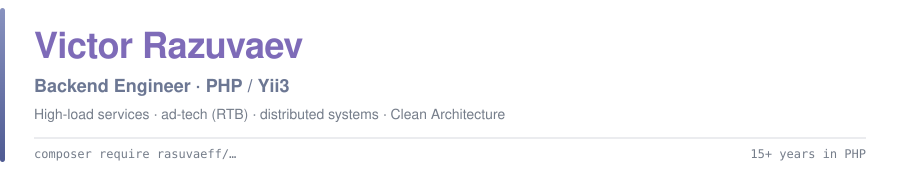

 

---

### 👨‍💻 About

Backend engineer with 15+ years of commercial PHP. I design and build high-load services and APIs — and I publish the reusable parts as open source: 89 packages on Packagist so far.

- **10 years in ad-tech**: advertising networks with RTB (Real-Time Bidding) integrations, buying and selling traffic — MySQL for operational data, ClickHouse for impression analytics, Redis/Memcached for caching.
- **Now**: product development on Yii3 / PHP 8.5 with Clean Architecture (Domain / Application / Infrastructure / Endpoint, boundaries enforced statically by Deptrac), plus support and refactoring of large Yii2 legacy systems.
- **LLM in production**: the application acts as an MCP server — assistants connect over Model Context Protocol and call domain tools via tool-calling, guarded by per-user RBAC and an audit log.
- I care about the things that are invisible until they break: retries, idempotency, exactly-once delivery, backpressure, mutation-tested code.

---

### ⚡ Tech Stack

**Languages**

**Frameworks**

**Data**

**Infrastructure & Real-time**

**AI / LLM**

**Quality**

---

### 📦 Open Source — [packages on Packagist](https://packagist.org/packages/rasuvaeff/)

**89 packages** — reusable PHP 8.3+ libraries with hardened CI/CD, SemVer, backward-compatibility checks, and tests on [Testo](https://php-testo.github.io) with mutation testing (MSI 85–100%).

How one person ships this many: see [Workflow](#-workflow--llm-driven-human-gated) below.

Built to be used by AI coding assistants too: every package ships an `llms.txt` API reference, and 40 of them ship an agent skill (`SKILL.md`) that projects using the [llm/skills](https://github.com/roxblnfk/skills) Composer plugin pick up on `composer install`.

Five that show the range:

| Package | What it does |
|---|---|
| [**yii3-ab-testing**](https://github.com/rasuvaeff/yii3-ab-testing) · [docs](https://rasuvaeff.github.io/yii3-ab-testing/) | Deterministic A/B testing for Yii3 — stateless hash-based assignment (same subject, same variant, every time, no session state), weighted variants, forced variant for QA, explicit exposure/conversion tracking. A full family: `-db`, `-clickhouse`, `-web`, `-outbox` |
| [**context**](https://github.com/rasuvaeff/context) | Deadlines, cancellation and request-scoped values for PHP — Go's `context.Context` idea, with no dependencies. One budget follows a request through every layer: HTTP client timeouts (`-http`), database-side statement timeouts on MySQL / MariaDB / PostgreSQL (`-db`), graceful shutdown of CLI workers on OS signals (`-cli`), external processes stopped when the deadline passes (`-process`). The docs say plainly where an in-flight call cannot be aborted |
| [**yii3-mcp**](https://github.com/rasuvaeff/yii3-mcp) · [docs](https://rasuvaeff.github.io/yii3-mcp/) | MCP server for Yii3 on the official `mcp/sdk`: domain operations become LLM tools through attributes, operations from an OpenAPI spec are bridged as tools — and, the part generic MCP servers skip, per-user RBAC, an audit log and telemetry on everything the model touches |
| [**property-testing-core**](https://github.com/rasuvaeff/property-testing-core) · [docs](https://rasuvaeff.github.io/property-testing-core/) | Framework-agnostic property-based testing **engine**: generators with integrated shrinking, a structured runner, regression corpus, lifecycle events — plus stateful/model-based testing. No test-framework dependency; Testo and PHPUnit adapters plug it in |
| [**understudy**](https://github.com/rasuvaeff/understudy) · [docs](https://rasuvaeff.github.io/understudy/) | Test doubles where the stubbed call is a real call: `when(fn () => $repo->find(1))->returns($book)` — no method names in strings, so a rename or a wrong argument is a type error before the test runs. Testo and PHPUnit adapters, Psalm and PHPStan plugins |

<b>The rest of the ecosystem</b> — resilience, observability, payments, files, testing, Yii3 infrastructure

 

| Area | Packages |
|---|---|
| **Resilience** | [resilience](https://github.com/rasuvaeff/resilience) — retry, circuit breaker and bulkhead composed in the right order · [retry](https://github.com/rasuvaeff/retry) · [circuit-breaker](https://github.com/rasuvaeff/circuit-breaker) · [bulkhead](https://github.com/rasuvaeff/bulkhead) · [duration](https://github.com/rasuvaeff/duration) · [result](https://github.com/rasuvaeff/result) |
| **Context & cancellation** | [context](https://github.com/rasuvaeff/context) (+ `-cli`, `-db`, `-http`, `-process`) — deadlines, cancellation and request-scoped values that follow a request through HTTP calls, DB statement timeouts, CLI worker shutdown and subprocesses |
| **Delivery** | [yii3-outbox](https://github.com/rasuvaeff/yii3-outbox) (+ `-db`, `-clickhouse`) · [yii3-webhooks](https://github.com/rasuvaeff/yii3-webhooks) (+ `-db`) · [yii3-outbox-webhooks-bridge](https://github.com/rasuvaeff/yii3-outbox-webhooks-bridge) · [yii3-idempotency](https://github.com/rasuvaeff/yii3-idempotency) (+ `-db`, `-redis`) — safe request retries via `Idempotency-Key` |
| **Experiments** | [yii3-feature-flags](https://github.com/rasuvaeff/yii3-feature-flags) (+ `-db`, `-ui`) · [yii3-ab-testing](https://github.com/rasuvaeff/yii3-ab-testing) (+ `-db`, `-clickhouse`, `-web`, `-outbox`) |
| **Attribution** | [yii3-utm](https://github.com/rasuvaeff/yii3-utm) (+ `-db`) — UTM/click-id capture, touchpoint history in one cookie, consent-gated middleware, append-only attribution journal |
| **Observability** | [yii3-telemetry](https://github.com/rasuvaeff/yii3-telemetry) (+ `-otel`) · [yii3-metrics](https://github.com/rasuvaeff/yii3-metrics) (+ `-prometheus`) · [yii3-correlation-id](https://github.com/rasuvaeff/yii3-correlation-id) · [yii3-health-check](https://github.com/rasuvaeff/yii3-health-check) · [yii3-audit-log](https://github.com/rasuvaeff/yii3-audit-log) (+ `-db`) · [domain-monitor](https://github.com/rasuvaeff/domain-monitor) |
| **AI / LLM** | [yii3-mcp](https://github.com/rasuvaeff/yii3-mcp) · [yii3-mcp-rbac-bridge](https://github.com/rasuvaeff/yii3-mcp-rbac-bridge) · [yii3-mcp-audit-log-bridge](https://github.com/rasuvaeff/yii3-mcp-audit-log-bridge) · [yii3-mcp-telemetry-bridge](https://github.com/rasuvaeff/yii3-mcp-telemetry-bridge) |
| **Payments** | [payments](https://github.com/rasuvaeff/payments) — provider-neutral payment contracts, PSR-18 transport and webhook pipeline · [payments-testing](https://github.com/rasuvaeff/payments-testing) — deterministic fake gateways and framework-agnostic contract assertions |
| **Yii3 infrastructure** | [yii3-tenancy](https://github.com/rasuvaeff/yii3-tenancy) (+ `-db`) · [yii3-settings](https://github.com/rasuvaeff/yii3-settings) (+ `-db`, `-ui`) · [yii3-workflow](https://github.com/rasuvaeff/yii3-workflow) (+ `-db`) · [yii3-api-problem](https://github.com/rasuvaeff/yii3-api-problem) · [yii3-maintenance-mode](https://github.com/rasuvaeff/yii3-maintenance-mode) · [yii3-seo](https://github.com/rasuvaeff/yii3-seo) · [yii3-centrifugo](https://github.com/rasuvaeff/yii3-centrifugo) · [yii3-respect-validation](https://github.com/rasuvaeff/yii3-respect-validation) · [yii3-recaptcha](https://github.com/rasuvaeff/yii3-recaptcha) · [yii3-turnstile](https://github.com/rasuvaeff/yii3-turnstile) |
| **Files** | [yii3-filestorage](https://github.com/rasuvaeff/yii3-filestorage) (+ `-db`, `-flysystem`, `-web`, `-attachments`, `-images`) — DI-native storage facade over swappable backends, deduplication ledger, signed downloads, tenant-scoped attachments, named-preset image derivatives |
| **Media** | [media-converter](https://github.com/rasuvaeff/media-converter) — type-safe ffmpeg/ffprobe wrapper: transcode/remux/filter pipeline, retry + bulkhead, progress events, DRM-aware probing |
| **HTTP & semantics** | [pinned-http-client](https://github.com/rasuvaeff/pinned-http-client) — PSR-18 client for untrusted URLs: resolves the host, checks every address, pins the connection · [link-preview](https://github.com/rasuvaeff/link-preview) — SSRF-safe OpenGraph / Twitter Cards extraction · [json-ld](https://github.com/rasuvaeff/json-ld) — JSON-LD 1.1 processor: expand, flatten, node API, RDF, N-Quads |
| **Query & domain** | [specification](https://github.com/rasuvaeff/specification) — Specification pattern, composable type-safe query building · [schema](https://github.com/rasuvaeff/schema) — schema-as-code combinators: one definition drives runtime validation, property-based generation and JSON Schema export |
| **ClickHouse** | [clickhouse-toolkit](https://github.com/rasuvaeff/clickhouse-toolkit) · [yii3-clickhouse-toolkit](https://github.com/rasuvaeff/yii3-clickhouse-toolkit) |
| **Property-based testing** | [property-testing-core](https://github.com/rasuvaeff/property-testing-core) adapters and extensions: [property-testing-testo](https://github.com/rasuvaeff/property-testing-testo) · [property-testing-phpunit](https://github.com/rasuvaeff/property-testing-phpunit) · [property-testing-names](https://github.com/rasuvaeff/property-testing-names) — realistic person names as inputs · [property-testing-openapi](https://github.com/rasuvaeff/property-testing-openapi) — requests generated from an OpenAPI document |
| **Testing & quality** | [understudy](https://github.com/rasuvaeff/understudy) (+ `-testo`, `-phpunit`, `-psalm`, `-phpstan`) — test doubles with a call-closure API and static-analysis plugins · [openapi-contract](https://github.com/rasuvaeff/openapi-contract) — framework-neutral OpenAPI contract validation for PSR-7 · [doc-exec](https://github.com/rasuvaeff/doc-exec) — doctest for PHP: executes fenced code blocks from docs, diffs the output · [quality-ledger](https://github.com/rasuvaeff/quality-ledger) · [mutation-history](https://github.com/rasuvaeff/mutation-history) — append-only quality ledgers with regression ratchets |
| **Tooling** | [rector-named-literals](https://github.com/rasuvaeff/rector-named-literals) · [rector-datetime-immutable](https://github.com/rasuvaeff/rector-datetime-immutable) · [ecosystem-sandbox](https://github.com/rasuvaeff/ecosystem-sandbox) — runnable checkout sandbox for the whole ecosystem (a demo application, not a package) |

---

### 🤖 Workflow — LLM-driven, human-gated

The honest answer to "how does one person [publish this many packages](https://packagist.org/packages/rasuvaeff/)?" is that the agent does the mechanical work inside a rulebook a human wrote — and that rulebook is [**php-package-toolkit**](https://github.com/rasuvaeff/php-package-toolkit), open source, so the claim is auditable rather than asserted.

**The loop**

1. **Scaffold from contract, not from scratch.** An agent generates each package from versioned templates plus a machine-checked rulebook (`AGENTS.md`). File layout, code style, CI pipeline, doc structure, and security rules are a fixed contract, never a per-project decision.
2. **Write, then gate.** The agent writes the code, tests, and docs, then runs the same gate every package must pass: Psalm **level 1 with zero suppressions**, mutation testing (MSI 85–100% — line coverage is not enough; the toolkit's `ER-003` writeup covers the difference), backward-compatibility checks before every major, SHA-pinned hardened CI, and [Testo](https://php-testo.github.io) tests with property-based coverage where invariants exist.
3. **Human owns the judgment.** I design the API, decide the abstractions and layer boundaries, review every change, and own release decisions. The agent never merges, tags, or publishes on its own — those are explicit human gates encoded in the skill workflows that drive each step.

What the agent makes cheap is execution, not judgment. Deciding what the right abstraction for a deadline-propagating context or a deterministic A/B engine looks like is the part I bring; the toolkit makes shipping it a matter of hours instead of weeks, without lowering the bar.

---

### 🔭 What I'm building

- **A sports fan site** (Yii3, PHP 8.5, PostgreSQL / Redis, Temporal, real-time via Centrifugo; built on my own packages) — match calendar with live updates, a long-running archive of player and head-to-head statistics, fan profiles, guestbook and private messages, admin panel.
- [**ecosystem-sandbox**](https://github.com/rasuvaeff/ecosystem-sandbox) — a runnable Yii3 shop that composes 60+ of my packages into one checkout and payment flow: outbox, idempotency, retries, circuit breaker, webhooks and telemetry working together, not just in isolation.
- **A fitness / training platform backend** (Yii3, PHP 8.5, PostgreSQL) — activity tracking with `.fit` file parsing, duels and leagues, JWT auth, S3 storage, real-time via Centrifugo, transactional outbox for event delivery. Strict Clean Architecture layering enforced by Deptrac; built on my own packages.

---

### 💡 What I like building

- Low-latency, high-load services where milliseconds and correctness both matter
- Distributed patterns done properly: outbox, idempotency, retries with backoff, bulkheads
- Libraries other people can depend on — documented, versioned, mutation-tested
- Making LLMs a first-class, permission-aware part of a backend rather than a bolt-on

---

### 📫 Contact

